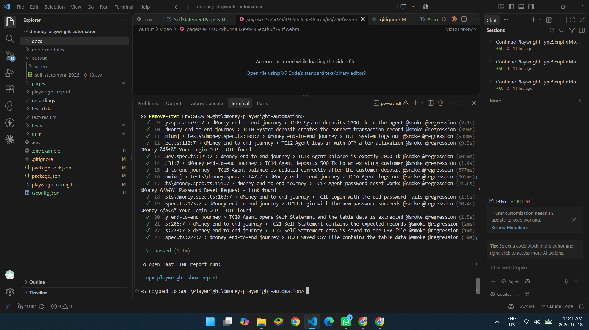
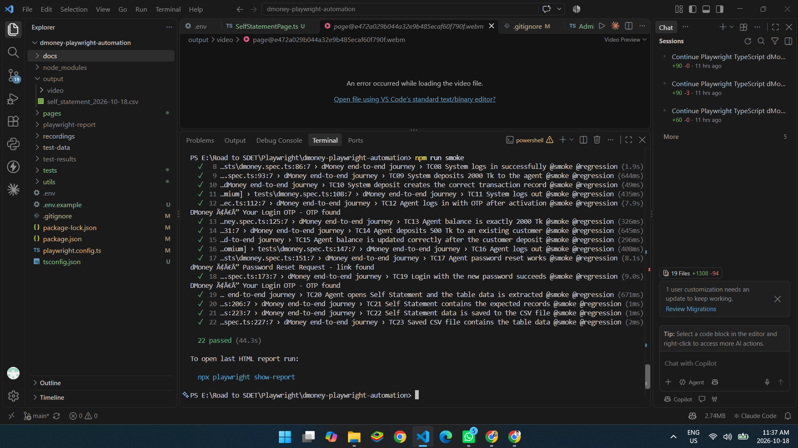

# dMoney Portal: Playwright End-to-End Automation

Automated end-to-end test suite for the **dMoney Portal** (`https://dmoneyportal.roadtocareer.net`), built with **Playwright + TypeScript** and the **Page Object Model**.
Assignment: *Road to SDET, Batch 19, Automation on Playwright*.

The suite automates one complete business journey: an Agent signs up, is activated by the Admin, receives money from the System account, deposits money to a Customer, resets their password, and exports their Self Statement to a CSV file. It covers **20 required validations** (23 test cases).

---

## Demo video

Full automation run in **headed mode** (recorded by Playwright, one video for the whole journey):

- Video file in this repository: [`recordings/dmoney-full-run.webm`](recordings/dmoney-full-run.webm)
[dmoney-full-run.webm](https://github.com/user-attachments/assets/a007cb7a-08d6-4382-ba11-edb99b501b08)

---

## Test results

### Regression Test Result (23 / 23 passed)



### SmokeTest Result (22 / 22 passed)



Sample CSV produced by the run: [`docs/sample-output/self_statement_2026-10-18.csv`](docs/sample-output/self_statement_2026-10-18.csv)

---

## The automated journey

1. Open the portal and sign up as an **Agent**.
2. Log in as **Admin** and activate the new agent.
3. Log out, log in as **System**, deposit **2000 Tk** to the agent.
4. Log out, log in as the new **Agent** (email OTP), verify balance is **2000 Tk**.
5. Deposit **500 Tk** to an existing **Customer** and verify success and the new balance.
6. Log out, **reset the agent password** (email link), verify the **old password fails**, log in with the **new password** (email OTP).
7. Open **Self Statement**, extract all table data and save it to `self_statement_<today>.csv`.

---

## Validations covered (20)

| # | Validation | Test case |
|---|-----------|-----------|
| 1 | Agent registration is successful | TC01 |
| 2 | Newly registered agent is initially inactive (PENDING) | TC04 |
| 3 | Admin login is successful | TC02 |
| 4 | Agent appears in the Admin user list | TC03 |
| 5 | Admin activates the agent | TC05 |
| 6 | Agent remains active after page reload | TC06 |
| 7 | System login is successful | TC08 |
| 8 | System deposits 2000 Tk to the agent | TC09 |
| 9 | Transaction record is correct (TXN ID, amount) | TC10 |
| 10 | Agent can log in after activation (OTP) | TC12 |
| 11 | Agent balance is exactly 2000 Tk | TC13 |
| 12 | Agent deposits 500 Tk to a customer | TC14 |
| 13 | Agent balance is updated correctly (1512.50 = 2000 - 500 + 12.50 commission) | TC15 |
| 14 | Customer deposit appears in the Self Statement | TC21 |
| 15 | Agent logout works | TC16 |
| 16 | Password reset works | TC17 |
| 17 | Login with the old password fails | TC18 |
| 18 | Login with the new password succeeds | TC19 |
| 19 | Self Statement contains the expected data | TC20, TC21 |
| 20 | Self Statement data is saved to the CSV file | TC22, TC23 |

TC07 and TC11 are the Admin and System logout steps that connect the journey.

---

## Tech stack

- **Playwright Test** with **TypeScript**
- **Page Object Model** (`pages/`)
- **@faker-js/faker** for fresh test data on every run
- **Gmail API** (read-only) to read the Agent's login OTP and the password-reset link
- **dotenv** for local secrets
- Reporters: list + HTML. Video recording on. `workers: 1` and a serial suite with one shared browser session

---

## Project structure

```
.
├── pages/                  Page objects
│   ├── BasePage.ts            logout, balance, shared locators
│   ├── RegisterPage.ts
│   ├── LoginPage.ts           login + OTP screen
│   ├── AdminUsersPage.ts      search, view, activate user
│   ├── CashInPage.ts          System and Agent deposits
│   ├── ResetPasswordPage.ts
│   └── SelfStatementPage.ts   table extraction
├── tests/
│   └── dmoney.spec.ts      End-to-end journey (TC01 to TC23), tagged @smoke / @regression
├── utils/
│   ├── testData.ts         Constants + random agent data generator
│   ├── gmailHelper.ts      Gmail API: waitForOtp, waitForResetLink
│   ├── csvHelper.ts        CSV write/read, date-stamped file name
│   └── session.ts          One shared browser context + video saving
├── docs/screenshots/       Regression and Smoke result screenshots
├── docs/sample-output/     Sample generated CSV
├── recordings/             Demo video
├── playwright.config.ts
├── .env.example            Template for local secrets
└── package.json
```

---

## Setup

**Prerequisites:** Node.js 18 or newer, and a personal Gmail account that will receive the Agent OTP and reset emails.

```bash
git clone https://github.com/Radouan1702/SDET-b19-playwright-dmoney.git
cd SDET-b19-playwright-dmoney
npm install
npx playwright install chromium
```

### Environment variables

Copy `.env.example` to `.env` and fill it in (`.env` is git-ignored and never committed):

```
GMAIL_ACCESS_TOKEN=<Gmail API access token>
GMAIL_BASE_EMAIL=<your gmail name without @gmail.com>
SLOW_MO=0
```

- The portal only accepts `@gmail.com` addresses at sign-up. Each run registers `GMAIL_BASE_EMAIL+agent<timestamp>@gmail.com`. Gmail delivers these plus-addresses to the same inbox, so every run gets a fresh unique agent.
- **How to get `GMAIL_ACCESS_TOKEN`:** open the [Google OAuth 2.0 Playground](https://developers.google.com/oauthplayground), authorize the scope `https://www.googleapis.com/auth/gmail.readonly` with your Gmail account, click *Exchange authorization code for tokens*, and copy the access token.
- The token expires after about **1 hour**. Refresh it before each run.

---

## Running the tests

| Command | What it does |
|---------|--------------|
| `npm run smoke` | Smoke suite: positive cases only (22 tests), headed |
| `npm run regression` | Full regression suite: all 23 tests, headed |
| `npm test` | Run everything headless |
| `npm run report` | Open the last HTML report |

Record a slower, easy-to-follow video of the full run:

```powershell
$env:SLOW_MO=400
npm run regression
Remove-Item Env:SLOW_MO
```

The video is saved to `output/video/dmoney-full-run.webm` and the CSV to `output/self_statement_<YYYY-MM-DD>.csv`.

### Smoke vs regression

- **`@smoke`**: all **positive** scenarios (TC01 to TC17, TC19 to TC23).
- **`@regression`**: everything in smoke **plus** the negative case TC18 (login with the old password fails).

---

## Design notes

- **Serial journey, shared session:** tests run in order and share one browser context and one generated agent, so a single video shows the whole flow. Each test is still one focused validation.
- **Fresh data every run:** name, email, phone, NID and passwords are generated, so runs never collide.
- **Web-first assertions only:** no fixed sleeps. Waits are `expect(...)` assertions, response waits, or polling.
- **Secrets stay local:** `.env` and the `output/` folder are in `.gitignore`.

## Notes

- Do not keep the generated CSV open in Excel while the tests run (Windows locks the file and the save step fails). Use VS Code or Notepad to view it.
- The agent balance after the customer deposit is `1512.50` because the portal credits a `12.50` deposit commission.

---

**Author:** Radouan1702, Road to SDET Batch 19
